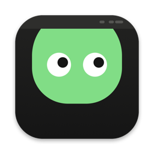

<p align="center"></p>

# peeko

[](https://github.com/STACK-42/peeko/actions/workflows/ci.yml)

**The to-do list that checks itself.** A small macOS menu bar app: you do the thing, your Mac sees the evidence, and Peeko ticks it off. **[peeko.stack42.tech](https://peeko.stack42.tech)**

Peeko hangs from the top of your screen and peeks at what you're doing. Keep a PDF open in Preview for half an hour and "Read for 30 minutes" ticks itself. Push to GitHub and that one goes green as well. Log off by 11 and it notices that too.

It isn't another to-do list. Everything in its catalog is something your Mac can actually check, so you don't spend the evening ticking boxes. (You can still add a few of your own if you want.)

It isn't there to police you. It's more like a little green creature that notices when you got something done and looks pleased about it.

## Where it's at

Early days. What works right now:

- the menu bar icon and popover, with a **Today** list and a **Catalog** of presets, plus a full window when you want more room
- manual tasks, plus your own custom ones
- tasks that count time in an app, like reading in Preview or deep work in your editor, including ones you set up yourself
- a daily "did I push to GitHub?" check
- "slept on time", "up before 8", "stopped working by 11", "lunch away from the screen" and "took your breaks", all from when you were actually at the keyboard
- "write in your notes" and "write 300 words", watching a notes folder or Obsidian vault you pick
- "stay under" limits, like under 45 minutes of YouTube, under 8 hours of screen time, or no social media before noon
- a 50-minute focus block in your editor, without wandering off
- "committed code today" across your local repos, "wrote today's daily note", a tidy Desktop, a Time Machine backup, and cleared Reminders
- "published something" for any blog or newsletter with an RSS feed, and a Duolingo lesson
- a note when Peeko ticks something off for you, and an optional evening reminder if anything's left
- a gentle nudge to get up and walk for 5 minutes after every hour at the screen (stepping away for 5 minutes resets it)
- a History tab with your streak, a five-week calendar, and how often you did each task
- export everything to one JSON file
- launch at login
- everything saved locally, with a fresh list each morning

Not built yet: auto-updates. For now, new versions are on the Releases page.

## Install

Paste this into Terminal:

```sh
curl -fsSL https://peeko.stack42.tech/install.sh | bash
```

It downloads the latest release, checks its checksum, puts Peeko in Applications, and opens it. Run it again any time to update. [Read the script](install.sh) first if you like; it's short.

Or do it by hand: grab `Peeko-x.y.z.dmg` from [Releases](https://github.com/STACK-42/peeko/releases), open it, and drag Peeko into Applications. Peeko isn't signed with an Apple Developer ID yet, so macOS will block it the first time you open it:

1. Open Peeko once and close the warning.
2. Go to **System Settings → Privacy & Security** and scroll down.
3. Click **Open Anyway** next to the Peeko message, then confirm.

You only have to do that once. The install script and building from source both skip it.

To uninstall, quit Peeko, then delete `/Applications/Peeko.app`. If you want your history gone too, delete `~/Library/Application Support/Peeko`.

## Privacy

There are no accounts, servers, or analytics. Your tasks and history are plain JSON files in `~/Library/Application Support/Peeko/`, so you can read them, back them up, or delete them whenever you like.

If you turn on the GitHub task, Peeko asks GitHub's public API for your public activity every 10 minutes, using the username you gave it. That's the only network request it makes. No token, so private repos don't count.

## How it decides you did something

Peeko only looks at a couple of simple signals:

- **Time in an app:** which app is in front, and whether you've touched the keyboard or mouse in the last couple of minutes. If both hold, the minute counts.
- **GitHub:** whether your public activity shows a push made today, in your own time zone.
- **When you're at the Mac:** the stretches of keyboard and mouse activity, used for the sleep and early-morning tasks. It only sees the Mac, not your phone in bed.
- **Website limits:** the title of the front window, to spot sites like YouTube. This needs Accessibility permission, and Peeko only asks when you turn on a limit that uses it.
- **Your notes folder:** which `.md` and `.txt` files changed today and how many words were added. Only the folder you pick, and nothing leaves your Mac.

These are proxies, not proof. Leave a PDF open and nudge the mouse now and then, and it will count as reading. That's fine. The point is a nudge, not a lie detector.

## Build it yourself

You need macOS 14 or later on an Apple silicon Mac, and Apple's Command Line Tools (`xcode-select --install`). You don't need Xcode.

```sh
git clone https://github.com/STACK-42/peeko.git
cd peeko
make run
```

That builds `build/Peeko.app` and opens it. Use `make install` instead to put it in Applications (launch at login works best from there). Look for the eyes in your menu bar. If your menu bar is crowded, macOS might hide the icon behind the `«` overflow; ⌘-drag it somewhere you can see it.

## Docs

- [Development setup](docs/development.md): toolchain, commands, and quirks
- [Architecture](docs/architecture.md): how the pieces fit together
- [Releasing](docs/releasing.md): packaging, versions, and signing
- [Blueprint](docs/blueprint.md): the original plan and roadmap
- [Brand](docs/brand/): the Peeko character, colors, and faces

## License

MIT. See [LICENSE](LICENSE).
